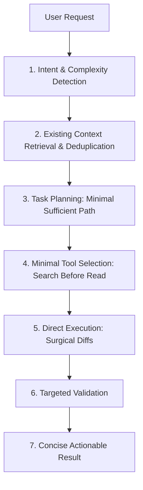

# 01 — Execution Pipeline & Request Lifecycle

## Pipeline Flow

Every user request in GeetorusAI passes through the optimized execution pipeline:

---

## Stage-by-Stage Architecture

### 1. Intent & Complexity Detection
- Handled automatically by `analyzeTaskComplexity(prompt)` in `@geetorusai/adapter-utils`.
- Categorizes request into:
  - `simple_direct`: Bypasses multi-turn planning; answers or modifies directly.
  - `code_modification`: Focuses on symbol identification, targeted diffing, and anti-duplication.
  - `product_development`: Decomposes milestones while maintaining standard library reuse.
  - `testing_validation`: Focuses on single-file, narrowest-possible test passes.
  - `security_sensitive`: Preserves authentication and authorization gates.

### 2. Context Retrieval & Deduplication
- `deduplicateContextChunks(chunks)` removes redundant instruction banners and overlapping text.
- Symbol searches (`grep_search`) isolate target functions and types before loading file content.
- Bounded context prevents unrelated memories from polluting the prompt.

### 3. Task Planning
- Complex projects receive dependency-aware execution plans.
- Simple requests proceed with single-step execution to conserve tokens and reduce latency.

### 4. Minimal Tool Selection
- Enforces deterministic, read-only tools first (file search before full file reads).
- Avoids repeated redundant tool calls for already known filesystem states.

### 5. Direct Execution
- Modifies exact code blocks via `replace_file_content` rather than rewriting entire files.
- Adheres to standard library built-ins over new npm dependencies.

### 6. Targeted Validation
- Executes narrowest possible verification (e.g. single Vitest file instead of full repo suites).
- Prohibits claiming test passes without actual test command execution.

### 7. Concise Actionable Deliverables
- Returns structured results with durable issue dispositions.
- Default responses are concise and direct, while delivering full code and documentation when requested.
