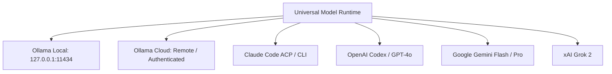

# 03 — Universal Model Runtime Compatibility

## Multi-Provider Support

GeetorusAI operates through a single universal execution contract across all supported providers:

---

## Provider Implementation Details

### 1. Local Ollama (`packages/adapters/ollama-local/`)
- **Endpoint**: `http://127.0.0.1:11434` (configurable via `host` or `OLLAMA_HOST`).
- **Discovery**: Queries `/api/tags` with a 6-second timeout.
- **Availability Enforcement**: Checks installed model list before starting tasks. If absent, halts immediately with `ollama pull <model>`. **No automatic downloading without explicit user consent.**
- **Failover Invariant**: No silent switching to paid or cloud models when a local model fails.

### 2. Ollama Cloud & Remote Gateways
- **Endpoint**: Remote HTTP/HTTPS gateway (e.g. `https://ollama.company.cloud`).
- **Authentication**: Secure `Authorization: Bearer <token>` via `apiKey` or `OLLAMA_API_KEY`.
- **Streaming & Tools**: Emits incremental NDJSON chunks; captures exact token counts on final frame.
- **Diagnostics**: Reports normalized 401/403 (Auth Failure), 429 (Rate Limit Exceeded), and 404 (Model Not Found) errors.

### 3. Frontier APIs (Claude, Codex, Gemini, Grok)
- Uses official SDKs and ACP subprocess sidecars.
- Supports streaming output and structured output where supported.
- Preserves native prompt caching discounts.
