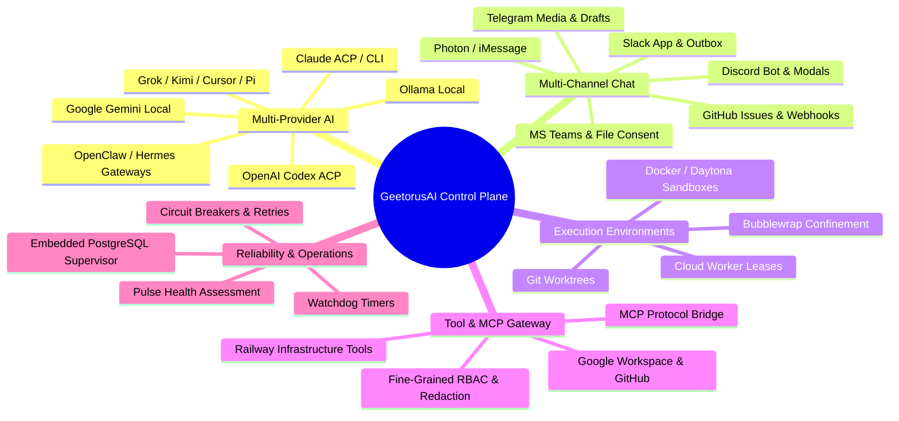

# 01 — Product Identity and Overview

## 1. Executive Summary

**GeetorusAI** is an enterprise-grade, autonomous AI agent control plane and multi-agent operations platform. Designed as a self-hosted, sovereign infrastructure solution, GeetorusAI enables engineering teams, product organizations, and enterprises to configure, deploy, orchestrate, supervise, and collaborate with autonomous AI agents across their real software development and business workflows.

Unlike simple chatbot wrappers or single-prompt agent runners, GeetorusAI provides a complete operational substrate:
- Multi-company and multi-team workspace isolation.
- Model-agnostic integration across 13+ frontier and local LLM ecosystems (Anthropic Claude, OpenAI Codex, Google Gemini, xAI Grok, Ollama, Moonshot Kimi, OpenClaw, Hermes, Cursor).
- Standardized Agent Client Protocol (ACP/ACPX) and Model Context Protocol (MCP) tool execution pipelines.
- Multi-channel conversational interfaces (Discord, Slack, Microsoft Teams, Telegram, GitHub issues/PRs, and iMessage/Photon).
- Isolated execution environments (Git worktrees, Docker/Daytona containers, Linux Bubblewrap sandboxes, cloud workers).
- Autonomous self-healing, health monitoring (Pulse), and automated circuit-breaker recovery.

---

## 2. Product Mission & Intended Users

### Core Mission
To provide an open, secure, observable, and extensible control plane that bridges autonomous AI reasoning with real-world engineering infrastructure without compromising security, multi-tenant boundaries, or auditability.

### Intended Users
1. **Engineering Leaders & Architects**: Establishing safe boundaries, secrets management, budget quotas, and observability for AI agents operating on company codebases.
2. **Software Developers & DevOps Engineers**: Delegating complex multi-step coding, debugging, refactoring, testing, and infrastructure tasks to AI agents working in isolated Git worktrees.
3. **Product & Operations Teams**: Orchestrating automated issue triaging, customer feedback processing, release generation, and cross-platform notifications.
4. **Autonomous AI Researchers & Tool Builders**: Extending agent capabilities via standardized MCP tools, dynamic plugin engines, and fine-grained decision models.

---

## 3. Core Problems Solved

| Problem in Agentic AI | GeetorusAI Architectural Solution |
| :--- | :--- |
| **Tool Sprawl & Security Risks** | Unified **Tool Gateway** with fine-grained access policies (`allow`, `deny`, `require_approval`), connection grants, token limits, and automatic credential redaction. |
| **Workspace Contamination** | Dynamic **Git Worktree Isolation** and container/Bubblewrap sandboxing, ensuring agents never execute dirty mutations on shared working directories. |
| **Vendor Lock-in** | Decoupled **Adapter Architecture** supporting 13 providers and ACP/ACPX standard sidecars. Switch models or local engines with zero application code changes. |
| **Uncontrolled Failures & Loops** | **Pulse Self-Healing Engine**, adaptive task watchdogs, error classifiers, and automated circuit breakers preventing runaway token spend and infinite loops. |
| **Communication Fragmentation** | Multi-channel **Chat Bridge** enabling bidirectional agent interaction via Discord, Slack, Teams, Telegram, and GitHub simultaneously. |
| **Context Loss Across Steps** | Persistent **Conversation Chronology**, structured issue thread interactions, artifact storage, and document revision tracking. |

---

## 4. Product Scope & Operational Boundaries

### What GeetorusAI Is
- A self-contained control plane server (`server/`) with comprehensive REST APIs and WebSocket streams.
- A rich Single Page Application (`ui/`) built with React 19 and modern CSS tokens.
- An embedded database runtime utilizing PostgreSQL (with zero external DB dependencies required for local bootstrap).
- A native process supervision and protocol runtime (`packages/geetorus-runner` + Rust runnerd + ACPX sidecars).
- A rich developer CLI (`cli/`) providing administration, migrations, backups, and live diagnostic tools.

### What GeetorusAI Is NOT
- **Not a Black-Box Hosted SaaS Only**: GeetorusAI is designed from the ground up for self-hosting, on-premise deployment, and data sovereignty.
- **Not an Unsupervised Autonomous Rogue Process**: Every mutating action, external HTTP request, and critical execution step is subject to RBAC, approvals, and strict audit logging.
- **Not AGI / Unbounded Self-Modification**: Agent capabilities are bounded strictly by assigned MCP tools, skill bundles, workspace policies, and authorization contexts.

---

## 5. Main Capabilities & Differentiators

### 1. Multi-Provider Agent Ecosystem
Supports 13 distinct adapter targets:
- Anthropic Claude (CLI and ACP via `@agentclientprotocol/claude-agent-acp`)
- OpenAI Codex (ACP via `@agentclientprotocol/codex-acp`)
- Google Gemini Local
- Ollama Local (local open-weight models)
- OpenClaw Gateway (bidirectional SSE events)
- Hermes & Hermes Gateway
- Cursor Cloud & Cursor Local
- Moonshot Kimi Local
- xAI Grok Local
- OpenCode Local
- Pi Local

### 2. Multi-Channel Conversational Orchestration
Bidirectional conversational sync allows users to interact with agents wherever they work:
- **Discord**: Interactive slash commands, modal forms, questions, and rich embeds.
- **Slack**: Ephemeral receipts, session outboxes, interactive modals, and thread persistence.
- **Microsoft Teams**: Adaptive cards, personal/channel routing, inline images, and file consent flows.
- **Telegram**: Media intake, video notes, ephemeral draft stops, and webhook/polling support.
- **GitHub**: Automatic issue comment wakeups, reactions, and pull request workflows.
- **Photon**: High-fidelity iMessage companion attachments and state receiver checkpoints.

### 3. Isolated Workspaces & Dynamic Environments
- **Git Worktree Manager**: Spawns isolated ephemeral worktree branches per issue, shielding primary branches from experimental agent changes.
- **Confinement & Sandboxing**: Linux Bubblewrap (`bwrap`) support for filesystem and network egress restriction; Docker and Daytona remote image provisioning.

### 4. Tool Gateway & MCP Protocol
- Full Model Context Protocol (MCP) server integration (`@geetorusai/mcp-server`) and Tool Gateway router.
- Native tool drivers for Railway SSH/deployment, GitHub PRs/commits, Google Sheets/Workspace, and custom plugin tools.
- Strict security boundaries: automatic secret redaction, parameter validation, and user approval gates.

### 5. Pulse Health Monitoring & Self-Healing
- Integrated **PulseService** checking API Gateway, Database, Model Providers, and Runner components every 30 seconds.
- Automated circuit breakers, error classification (Network, Rate Limit, Authentication, Context Window Overflow), and automatic failover to designated fallback models.

---

## 6. Current Implementation Status

| Component | Status | Implementation Evidence |
| :--- | :--- | :--- |
| **Control Plane Server** | `IMPLEMENTED_AND_VERIFIED` | `server/src/index.ts`, `server/src/app.ts` |
| **React 19 Frontend** | `IMPLEMENTED_AND_VERIFIED` | `ui/src/App.tsx`, `ui/src/pages/*` |
| **Embedded PostgreSQL Runtime** | `IMPLEMENTED_AND_VERIFIED` | `packages/db/src/migration-runtime.ts` |
| **137-Table Relational Schema** | `IMPLEMENTED_AND_VERIFIED` | `packages/db/src/schema/*.ts` |
| **Claude & Codex ACP Adapters** | `IMPLEMENTED_AND_VERIFIED` | `packages/adapters/claude-local`, `codex-local` |
| **Gemini, Grok, Ollama Adapters** | `IMPLEMENTED_AND_VERIFIED` | `packages/adapters/gemini-local`, `grok-local`, `ollama-local` |
| **OpenClaw & Hermes Gateways** | `IMPLEMENTED_AND_VERIFIED` | `packages/adapters/openclaw-gateway`, `hermes-gateway` |
| **Native Runner & ACPX Sidecar** | `IMPLEMENTED_AND_VERIFIED` | `packages/geetorus-runner/` |
| **MCP Server & Tool Gateway** | `IMPLEMENTED_AND_VERIFIED` | `packages/mcp-server/`, `server/src/services/tool-gateway.ts` |
| **Multi-Channel Chat (Discord/Slack/Teams/TG/GH)**| `IMPLEMENTED_AND_VERIFIED` | `server/src/services/chat-channels.ts` |
| **Pulse & Circuit Breakers** | `IMPLEMENTED_AND_VERIFIED` | `server/src/services/self-healing/`, `pulse/` |
| **CLI Administration Suite** | `IMPLEMENTED_AND_VERIFIED` | `cli/src/index.ts`, `cli/src/commands/*` |
| **Plugin SDK & Worker Sandbox** | `IMPLEMENTED_AND_VERIFIED` | `packages/plugins/` |

---

## 7. Supported Operating Environments

- **Operating Systems**: Linux (x86_64 / aarch64), macOS (Apple Silicon / Intel), Windows (Windows 10/11, Server 2022+ with PowerShell / WSL2).
- **Node.js Runtime**: `>= 24.11.0` required (strictly checked by `packages/shared/src/node-version.ts` and `scripts/check-node-version-policy.mjs`).
- **Package Manager**: `pnpm` (v9.15.4 pinned via `packageManager`).
- **Database**: Embedded PostgreSQL 18 (bundled via patched `embedded-postgres@18.1.0-beta.16`) or external PostgreSQL 15+ instance.
