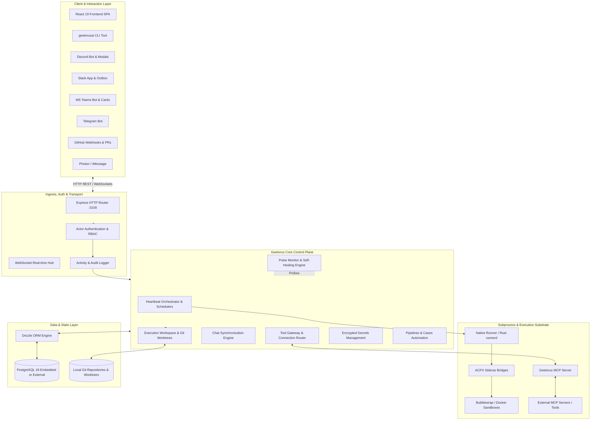
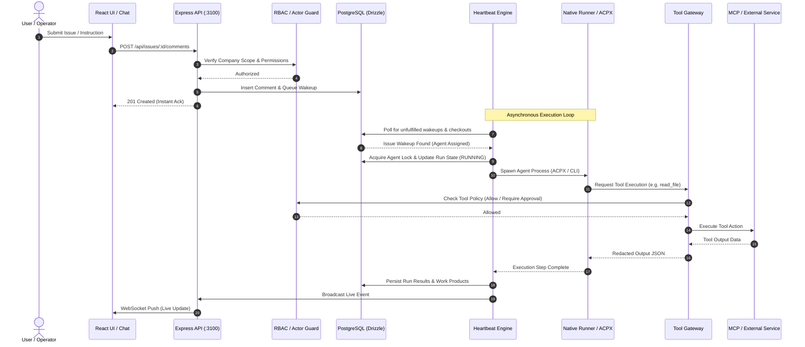

# 03 — System Architecture

## 1. High-Level System Architecture

GeetorusAI operates as a centralized multi-agent orchestration plane built on a micro-modular monolith pattern. It combines a high-throughput Node.js Express server with real-time WebSocket communication, an embedded/external PostgreSQL persistence tier, isolated execution worktrees, and native subprocess supervision.

---

## 2. Component Boundaries & Runtime Topology

### 1. Ingress & HTTP Server Boundary
- **Process**: Single Node.js process (`server/src/index.ts`) hosting Express (`server/src/app.ts`).
- **Ports**: Default `3100` (auto-detected fallback if busy via `detect-port`).
- **Protocols**:
  - HTTP 1.1 / 2 for REST endpoints (`/api/*`).
  - WebSocket on `/ws/live-events` (real-time company event bus).
  - WebSocket on `/ws/environment-custom-image-terminal` (interactive terminal streaming).
  - WebSocket on `/ws/runner-prp` (Process Runtime Provider v1).

### 2. Control Plane & Orchestration Boundary
- **Heartbeat Loop**: Configurable periodic ticker (default 10s-30s) scanning for actionable issues, agent wakeups, scheduled routines, and stuck execution watchdogs.
- **Actor Context Middleware**: Injects `actor` object into every request (`local_implicit`, `session`, `board_key`, `agent_key`, `agent_jwt`, `cloud_tenant`).
- **Company Scope Enforcer**: Strict SQL-level filtering ensuring cross-tenant queries cannot bleed data across companies.

### 3. Native Runner & Agent Execution Boundary
- **Subprocess Isolation**: Agents run as independent OS processes managed by `packages/geetorus-runner` or `@agentclientprotocol/claude-agent-acp` / `@agentclientprotocol/codex-acp`.
- **Confinement**:
  - **Linux**: Bubblewrap (`bwrap`) provides unprivileged user namespace isolation, mounting only the assigned worktree as `rw` and restricting network sockets.
  - **Docker / Daytona**: Ephemeral container provisioning for remote agent execution.
- **stdio / JSON-RPC Protocol**: Structured messaging via Agent Client Protocol (ACP) and Model Context Protocol (MCP).

---

## 3. Data Flow Architecture

### Synchronous vs. Asynchronous Request Paths

---

## 4. State Management Architecture

| Layer | Technology | State Responsibilities | Persistence Mechanism |
| :--- | :--- | :--- | :--- |
| **Frontend State** | React Context + TanStack Query / Hooks | Active company, user session, optimistic UI cache, open dialogs | Browser memory + localStorage |
| **Server State** | In-Memory Registries + Express Middleware | Circuit breaker statuses, active WebSocket subscribers, dev-runner PID | Memory (recalculated on boot) |
| **Persistent Business State** | PostgreSQL 18 + Drizzle ORM | 137 entity tables (Issues, Agents, Runs, Secrets, Pipelines, Decisions) | Embedded or External PostgreSQL |
| **Workspace State** | Git Repositories & Worktrees | Source code, branches, commit logs, uncommitted diffs | Local Filesystem (`~/.geetorus/data/workspaces`) |
| **Subprocess State** | ACP / ACPX Session Directories | Local LLM caches, session conversation transcripts | Disk (`~/.geetorus/data/agents/:id/state`) |

---

## 5. Security & Isolation Boundaries

1. **Company Isolation Boundary**: All database tables with company-level scoping include a `company_id` foreign key. The `actorMiddleware` verifies company membership before routing to business logic.
2. **Secret Redaction Boundary**: The `RedactionService` scrubs API keys, private tokens, and passwords from all tool outputs, logs, and live event broadcasts before they exit the server.
3. **Tool Access Authorization Boundary**: Every tool invocation passes through `toolAccessService.evaluateDecision()`, enforcing `allow`, `deny`, or `require_approval` gates.
4. **Execution Worktree Boundary**: Worktrees prevent agents from corrupting the master branch or colliding with concurrent agent runs.
