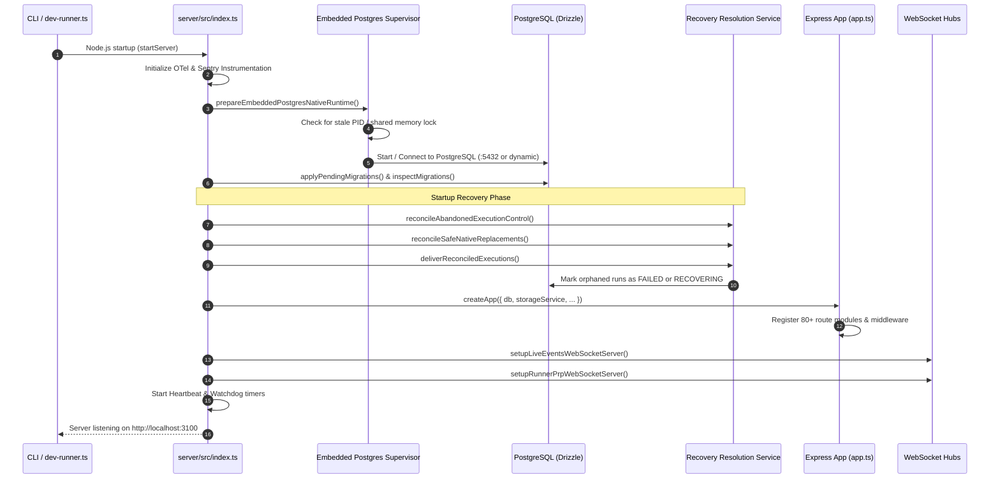
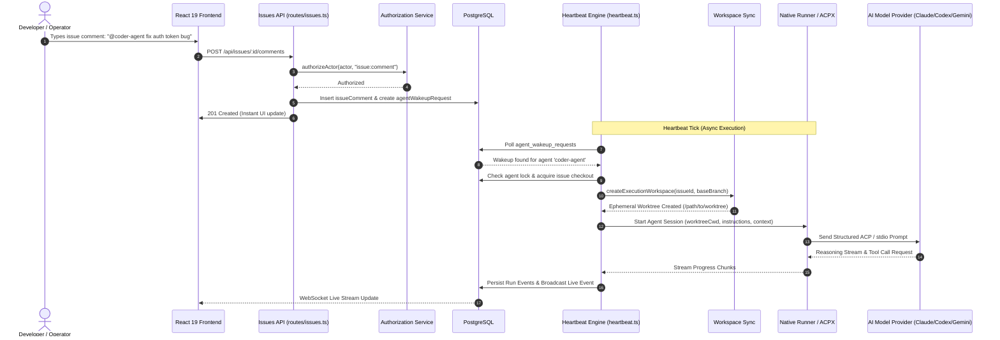
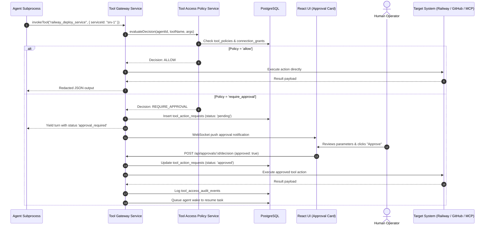
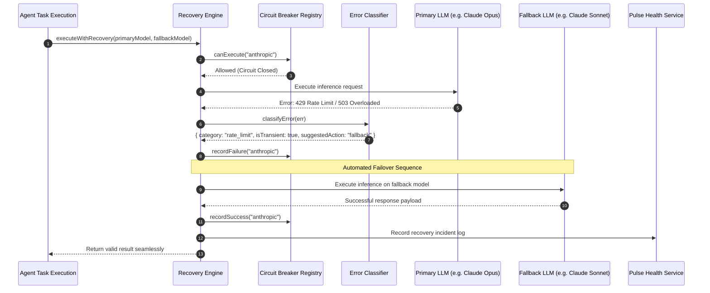

# 05 — Complete Functional Flows

This document details the actual execution sequences for primary user journeys and system operations in GeetorusAI, complete with Mermaid sequence diagrams, function call chains, and failure recovery paths.

---

## 1. Application Startup & Crash Recovery Flow

### Step-by-Step Breakdown:
1. **Trigger**: Developer runs `pnpm dev` or Docker container boots.
2. **Instrumentation**: `instrumentationReady` and `sentryReady` bootstrap OpenTelemetry and Sentry before opening database connections.
3. **Database Supervisor**: `prepareEmbeddedPostgresNativeRuntime()` ensures PostgreSQL is alive. On Windows, it cleans orphaned PID locks to prevent shared memory block crashes.
4. **Migration Engine**: Drizzle schema migrations are inspected and applied sequentially.
5. **Crash Reconciliation**:
   - `reconcileAbandonedExecutionControl()` finds active task sessions that were interrupted by an ungraceful server shutdown.
   - Settles unrecoverable executions and logs recovery events.
6. **HTTP & WebSocket Ingress**: Express router mounts routes and starts listening on port 3100. Real-time WebSocket hubs open for live UI event streaming.

---

## 2. User Chat & Multi-Agent Issue Execution Flow

---

## 3. Tool Invocation & Human Approval Gate Flow

---

## 4. Self-Healing, Circuit Breakers & Failover Flow

