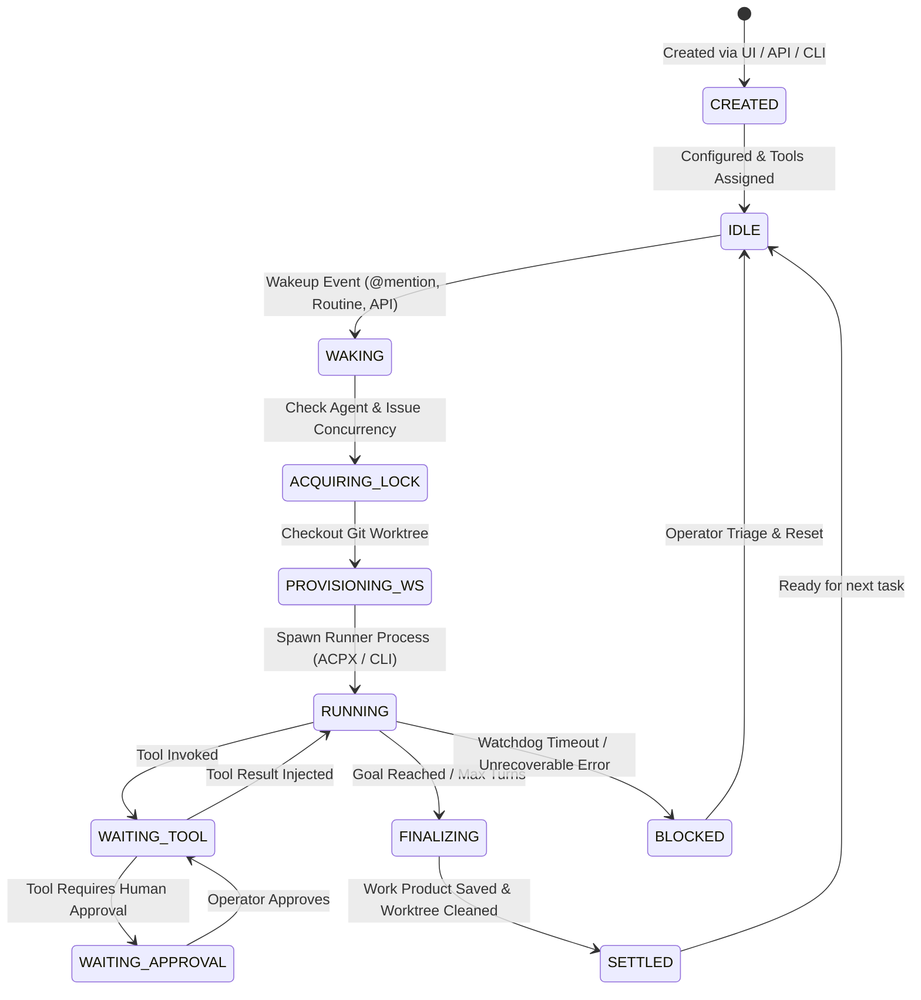
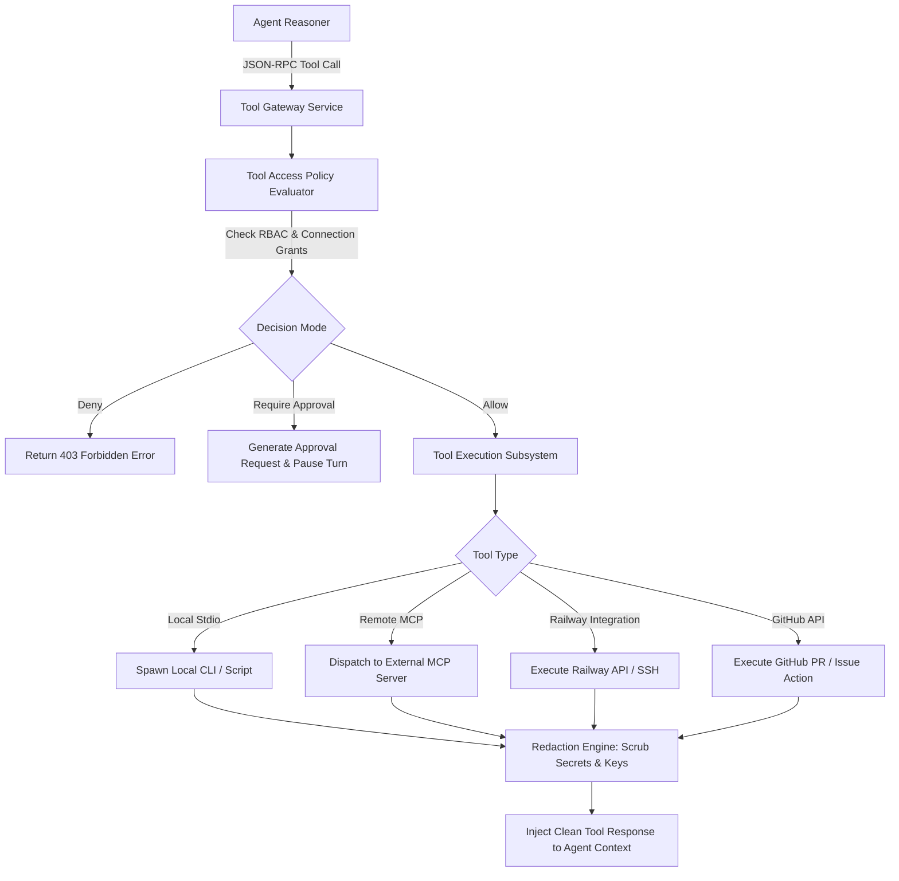

# 08 — Agent System and Tool Execution

GeetorusAI treats AI agents as first-class operational entities with defined lifecycles, permissions, tool boundaries, working memory, and execution worktrees.

---

## 1. Agent Architecture & Lifecycle

---

## 2. Planning & Task Decomposition

When agents receive large or ambiguous issues, GeetorusAI triggers structured task plan decomposition:
- **`issue_plan_decompositions` Schema**: Stores sub-tasks, dependencies, completion criteria, and order of operations.
- **Hierarchical Issues**: Agents can spawn sub-issues, assign child tasks to specialized peer agents (e.g. `@tester-agent`, `@docs-agent`), and wait for completion signals.
- **Completion Contracts**: The `completion_contracts` table enforces verifiable exit criteria before an agent can transition an issue to `COMPLETED`.

---

## 3. Tool Gateway & Execution Pipeline

### Supported Core Tool Categories:
1. **File & Workspace Tools**: `read_file`, `write_file`, `list_dir`, `grep_search`, `git_commit`, `git_diff`.
2. **Issue & Communication Tools**: `geetorusAddComment`, `geetorusCreateIssue`, `geetorusAskUserQuestions`, `geetorusRequestConfirmation`.
3. **Infrastructure & Deployment Tools**: `railway_deploy_service`, `railway_ssh_exec`, `docker_container_run`.
4. **Integration Tools**: Google Sheets MCP, Google Workspace, GitHub PR review, Notion, PostHog.

---

## 4. Confinement, Sandboxing & Resource Management

| Isolation Mechanism | Supported OS | Implementation Details |
| :--- | :--- | :--- |
| **Git Worktree Isolation** | All Platforms | Every task operates in a unique worktree path (`.geetorus/worktrees/issue-XYZ`). Never mutates the active branch directly. |
| **Bubblewrap Confinement** | Linux | Unprivileged namespace sandbox restricting filesystem access to `rw` inside worktree and blocking raw network sockets. |
| **Docker / Daytona Sandbox** | Linux / macOS / Windows | Spins up ephemeral containers with custom image templates (`environment_custom_image_templates`). |
| **Process Watchdogs** | All Platforms | `TaskWatchdogService` kills hung processes after configurable `timeoutSec` (default 600s) and records stack traces. |
| **Loop Prevention** | All Platforms | Maximum turns per session (`maxTurnsPerRun`, default 25) prevents runaway agent execution loops. |
