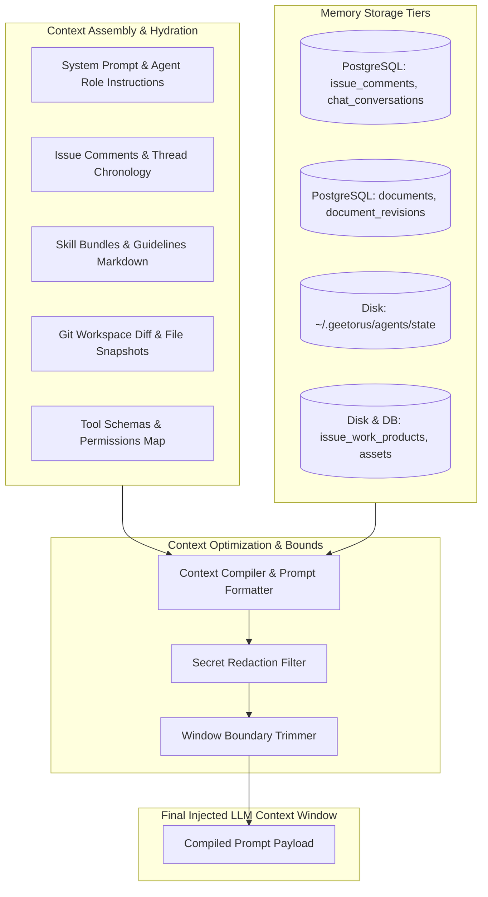

# 09 — Memory and Knowledge Management

This document details how GeetorusAI structures, manages, compresses, and retrieves context across agent executions, user conversations, and collaborative issue threads.

---

## 1. Context & Memory Architecture

---

## 2. Memory Tiers & Persistence

### 1. Short-Term Working Context (Session Memory)
- **Scope**: A single active heartbeat run or interactive chat session.
- **Persistence**: Managed by the runner process (ACP session state files on disk or in-memory process buffers).
- **Contents**: Turn-by-turn reasoning chains, tool input arguments, raw tool outputs, and user question-response pairings.

### 2. Episodic Conversation History (Thread Memory)
- **Scope**: An entire issue discussion, PR thread, or external chat channel.
- **Persistence**: `issue_comments`, `chat_conversations`, `chat_deliveries`.
- **Chronology**: Ordered deterministically using monotonically increasing sequence IDs and timestamps.

### 3. Long-Term Knowledge & Semantic Documents
- **Scope**: Reusable company knowledge, project guidelines, coding standards, and architectural documents.
- **Persistence**: `documents`, `document_revisions`, `document_annotation_threads`.
- **Skills System**: Agents dynamically load domain-specific skill bundles from `packages/skills-catalog` and `company_skills`.

---

## 3. Context Window Optimization & Compression

1. **Incremental Diff Reprojection**: Rather than sending full repository trees, agents receive compact Git diffs (`git diff HEAD~1`) and file slice views (`StartLine`/`EndLine`).
2. **Context Window Overflow Handling**:
   - `ErrorClassifier` detects `context_overflow` error codes from providers.
   - Triggers automated context trimming, stripping oldest turn outputs while retaining system instructions and recent thread comments.
3. **Structured Summary Slots**: `summary_slots` store high-density summary snapshots of long-running issue threads to prevent unbounded token consumption.

---

## 4. Privacy & Data Isolation

- **Company Boundary**: Agents can only read documents, comments, and skills explicitly associated with their assigned `company_id`.
- **Zero Cross-Contamination**: Multi-tenant database queries enforce foreign key isolation.
- **No Third-Party Vector Leakage**: Embeddings and search indexes operate locally within the company scope; vector data is never shared across organizations.
