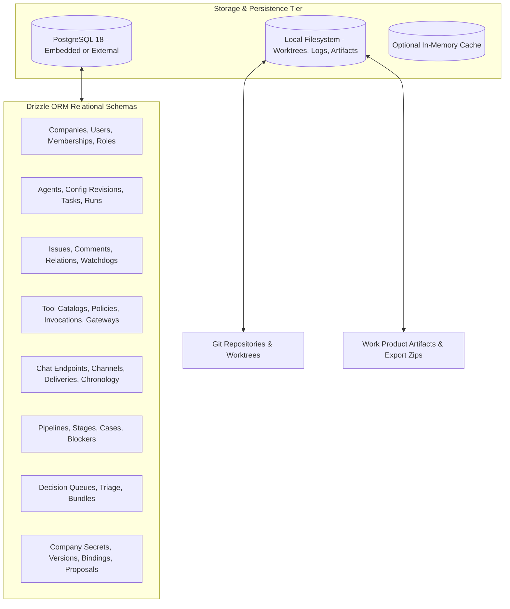
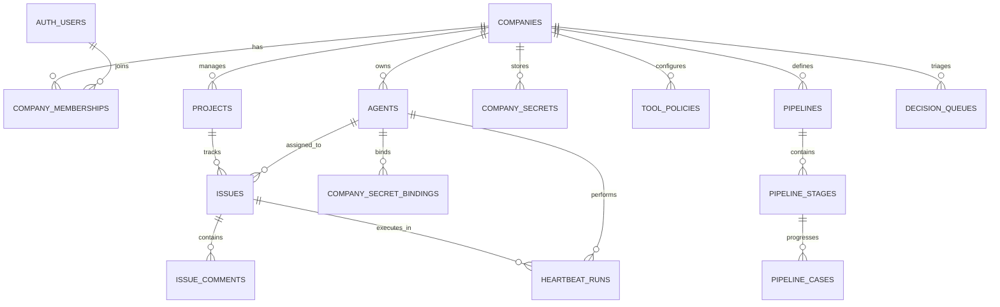

# 10 — Data Model and Storage

GeetorusAI uses a strongly-typed, relational data architecture backed by **PostgreSQL** and managed through **Drizzle ORM** (`packages/db`).

---

## 1. Storage Architecture Overview

---

## 2. Core Entity Relationship Model

---

## 3. Key Schema Domains (137 Tables)

### 1. Multi-Tenancy & Identity (`auth.ts`, `companies.ts`, `instance_settings.ts`)
- `companies`: Primary tenant boundary (`id`, `name`, `slug`, `created_at`).
- `auth_users`: User credentials, email, password hash, MFA status.
- `company_memberships`: Join table linking users to companies with specific roles (`owner`, `admin`, `member`, `contractor`, `observer`).
- `instance_user_roles`: Instance-wide administrative privileges.
- `instance_settings`: Global feature flags, auth mode, domain allowlists, telemetry opt-in.

### 2. Agents & Runtime State (`agents.ts`, `heartbeat_runs.ts`, `agent_task_sessions.ts`)
- `agents`: Agent profiles, assigned model adapter, role instructions, runtime limits, budget caps.
- `agent_config_revisions`: Versioned history of agent configuration changes.
- `heartbeat_runs`: Complete execution trace of an agent run (status, start/end time, token cost, exit code).
- `heartbeat_run_events`: Granular streaming timeline events emitted during an execution turn.

### 3. Issues & Task Management (`issues.ts`, `issue_comments.ts`, `issue_relations.ts`)
- `issues`: Multi-agent tasks (`title`, `description`, `status`, `priority`, `assignee_agent_id`, `assignee_user_id`).
- `issue_comments`: Threaded comments, user directives, agent status updates.
- `issue_plan_decompositions`: Structured breakdowns of complex tasks into child steps.
- `issue_watchdogs`: Timeout tracking, stalled execution detection, recovery thresholds.

### 4. Tool Access & Gateway (`tool_access.ts`, `tool_gateway.ts`)
- `tool_catalog_entries`: Registered MCP tools, system commands, and integration definitions.
- `tool_policies`: Fine-grained rules (`allow`, `deny`, `require_approval`) per agent/company.
- `tool_invocations`: Historical audit log of every tool execution, parameters, and output hashes.
- `tool_mcp_gateways`: Secure MCP server bridge endpoints with token authentication.

### 5. Secrets Management (`company_secrets.ts`, `company_secret_versions.ts`)
- `company_secrets`: Key definitions and metadata (encrypted at rest).
- `company_secret_versions`: Immutable versioned payloads of secret values.
- `company_secret_proposals`: User-submitted secret updates awaiting administrator review.

---

## 4. Migrations & Backup Strategies

- **Drizzle Migrations**: Schema migrations live in `packages/db/drizzle/` and apply automatically on startup via `applyPendingMigrations()`.
- **Database Backup Service**:
  - Script: `scripts/backup-db.sh` & CLI command: `geetorusai db backup`.
  - Generates compressed PostgreSQL dump archives with schema verification.
- **Embedded vs External Database**:
  - **Embedded**: Uses `embedded-postgres@18.1.0-beta.16` storing state in `~/.geetorus/data/postgres`. Ideal for single-node / local setup.
  - **External**: Connects to any standard PostgreSQL 15+ cluster via `DATABASE_URL`.
