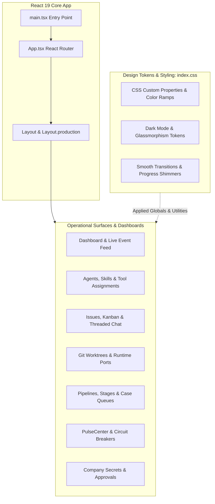

# 11 — Frontend and User Experience

The GeetorusAI frontend is a state-of-the-art Single Page Application (SPA) built on **React 19**, **Vite**, and a comprehensive design system defined in `ui/src/index.css`.

---

## 1. UI Architecture & Design System

---

## 2. Design Token System (`ui/src/index.css`)

The application avoids arbitrary hex codes and magic pixel values, utilizing structured design tokens:
- **Color Scales**: Systematic ramps for surfaces, borders, primary accents, muted text, status badges (`status-healthy`, `status-degraded`, `status-critical`).
- **Glassmorphism & Elevation**: Layered translucent surfaces with backdrop blur (`backdrop-blur-md`, subtle border highlights).
- **Typography**: Clean font stacks optimized for code readability, metrics, and dense dashboards.
- **Micro-Animations**: Real-time status indicators, pulsating pulse dots, streaming terminal carets, and animated SVG icons (`AnimatedGeetorusIcon.tsx`).

---

## 3. Key Pages & Routes Inventory

| Route Path | Page Component | Functional Purpose |
| :--- | :--- | :--- |
| `/:companySlug/dashboard` | `Dashboard.tsx` | Overview of active agents, open issues, system health, and live activity stream. |
| `/:companySlug/agents` | `Agents.tsx` | Agent directory, status filters, creation wizard, and performance metrics. |
| `/:companySlug/agents/:id` | `AgentDetail.tsx` | Agent instruction editor, model selector, tool assignments, and live run terminal. |
| `/:companySlug/issues` | `Issues.tsx` | Multi-agent issue tracker with list, kanban, and priority filtering views. |
| `/:companySlug/issues/:id` | `IssueDetail.tsx` | Threaded discussion, @agent trigger, task plan decomposition, approval cards. |
| `/:companySlug/workspaces` | `Workspaces.tsx` | Git worktree manager, branch diffs, service port forwarding. |
| `/:companySlug/pipelines` | `Pipelines.tsx` | Multi-stage business pipeline visualizer, automated stage triggers. |
| `/:companySlug/secrets` | `Secrets.tsx` | Company secret vault, versioning history, user proposal review. |
| `/:companySlug/skills` | `CompanySkills.tsx` | Skill catalog, markdown authoring studio (`SkillStudio.tsx`), tool bindings. |
| `/:companySlug/pulse` | `PulseCenter.tsx` | Real-time system health dashboard, circuit breaker status, incident history. |
| `/:companySlug/adapters` | `AdapterManager.tsx` | AI provider configuration, model discovery, credential testing. |
| `/auth` | `Auth.tsx` | User login, registration, SSO, invitation acceptance. |

---

## 4. Real-Time Chat & Terminal Streaming Experience

### 1. Interactive Issue Chat
- **Threaded Mentions**: Typing `@agent-name` triggers autocomplete and automatically queues an agent wake request upon comment submission.
- **Question Cards**: When an agent requests clarification via `geetorusAskUserQuestions`, the UI renders structured interactive forms (radio options, text fields, confirmations).
- **Approval Cards**: Sensitive tool executions generate high-visibility approval banners with diff inspectors and one-click "Approve" / "Reject" controls.

### 2. Live Run Terminal & Observability
- **Streaming Chunks**: Agent token generation streams live into Monaco/CodeMirror terminal views without blocking UI interactions.
- **Trace Inspector**: Operators can inspect step-by-step reasoning chains, raw tool input JSON, executed command output, and token cost accumulation in real-time.
