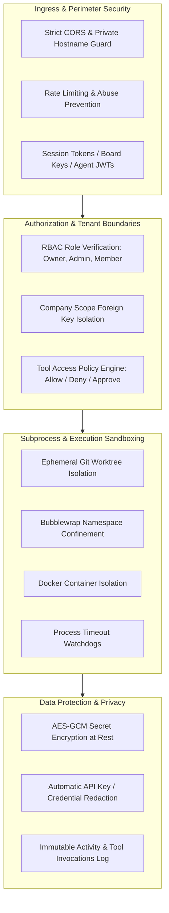
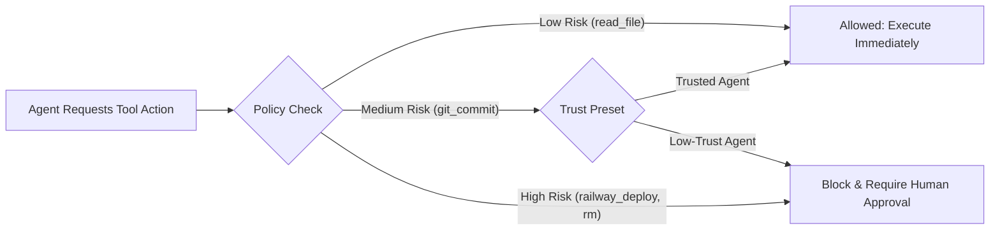

# 12 — Security and Privacy Audit

GeetorusAI implements a defense-in-depth security model across every layer of the architecture, recognizing the unique risks posed by autonomous AI code execution, tool invocations, and multi-tenant data management.

---

## 1. Security Architecture & Threat Model

---

## 2. Authentication & Authorization (RBAC)

### 1. Multi-Principal Authentication
- **User Sessions**: Managed via session cookies and bearer tokens (`authSessions` table).
- **Board API Keys**: Static high-entropy tokens for automated CI/CD and external systems (`board_api_keys` table).
- **Agent JWTs**: Ephemeral, cryptographically signed JWT tokens issued to agent subprocesses (`agent-auth-jwt.ts`). Tokens carry run-scoped IDs and expire immediately upon run completion.

### 2. Role-Based Access Control (RBAC)
- **`owner`**: Full company administration, billing, secret deletion, member removal.
- **`admin`**: Agent creation, tool policy configuration, secret creation, pipeline setup.
- **`member`**: Issue creation, commenting, agent wakeups, routine viewing.
- **`contractor`**: Restricted to assigned issues and read-only tool profiles.
- **`observer`**: Read-only dashboard access.

---

## 3. Tool Execution Security & Human-in-the-Loop

- **Policy Evaluation**: `toolAccessService.evaluateDecision()` evaluates the tool's impact before execution.
- **Approval Gate**: High-risk actions stop agent execution and create a `tool_action_requests` record. The agent cannot proceed until an authorized human approves the action in the UI.

---

## 4. Subprocess Isolation & File System Containment

1. **Git Worktree Isolation**: Agents execute inside ephemeral Git worktree checkouts. The primary working tree is never mounted with write permissions, preventing accidental working-directory corruption.
2. **Bubblewrap Confinement (`bwrap` on Linux)**:
   - Uses Linux unprivileged user namespaces to construct a minimal root filesystem.
   - Mounts host paths as read-only (`ro`); mounts only the assigned worktree as read-write (`rw`).
   - Private network namespace blocks direct raw socket creation unless explicit egress allowlisting is enabled.
3. **Command Execution Guard**: Arbitrary shell commands are routed through bounded executors with strictly validated argument arrays, preventing shell injection vulnerabilities.

---

## 5. Secret Management & Redaction Engine

- **Encryption at Rest**: Company secrets and AI provider keys are encrypted in PostgreSQL using AES-256-GCM.
- **Automated Output Redaction**: `RedactionService` intercepts all tool stdout, stderr, logs, and WebSocket live events, scrubbing recognized secret patterns, bearer tokens, and private keys before persistence or display.
- **Immutable Audit Logging**: Every mutating action, login challenge, tool invocation, and secret access event is written to `activity_log` and `tool_access_audit_events`.
