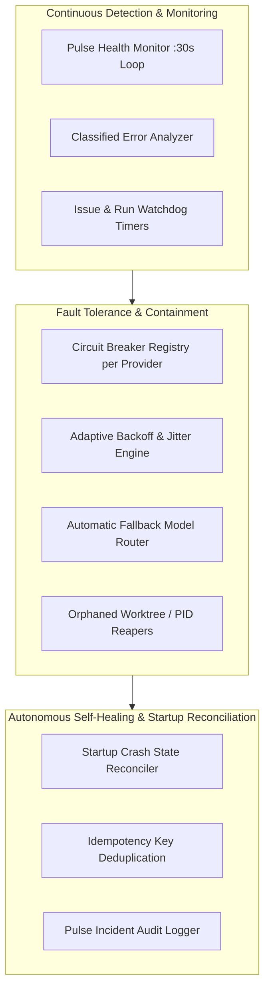

# 13 — Reliability, Errors, and Self-Healing

GeetorusAI incorporates a multi-tiered reliability and self-healing architecture designed to maintain operational stability despite network drops, LLM provider outages, rate limits, and ungraceful host restarts.

---

## 1. Reliability Architecture Overview

---

## 2. Self-Healing & Circuit Breakers (`server/src/services/self-healing/`)

### 1. Error Classification Engine (`error-classifier.ts`)
The `classifyError()` function analyzes incoming errors from LLMs, tools, and networks into deterministic categories:
- `network`: Transient connection reset / DNS timeout (eligible for immediate retry).
- `rate_limit`: HTTP 429 Too Many Requests (triggers exponential backoff).
- `auth`: HTTP 401/403 Invalid Credentials (immediate fatal stop; requires operator intervention).
- `context_overflow`: Context window exceeded (triggers automatic history compaction).
- `circuit_broken`: Provider temporarily disabled due to elevated error rates.

### 2. Circuit Breaker State Machine (`circuit-breaker.ts`)
- **States**: `closed` (normal operation) -> `open` (requests blocked after threshold consecutive failures) -> `half_open` (test probe allowed after cooldown).
- **Default Threshold**: 5 consecutive failures trips the breaker.
- **Cooldown Window**: 30 seconds default (`circuitBreakerCooldownMs`).
- **Automated Failover**: When a primary model's circuit breaker opens, `RecoveryEngine` seamlessly routes pending agent tasks to a designated fallback model (e.g., Claude Opus -> Claude Sonnet).

---

## 3. Crash Recovery & Startup Reconciliation

When GeetorusAI boots after an ungraceful shutdown or crash, `server/src/index.ts` executes a structured recovery sequence:
1. **Orphaned Lock Settle**: `reconcileAbandonedExecutionControl()` scans `heartbeat_runs` for tasks stranded in `RUNNING` status without an active process PID, marking them `FAILED` with a crash reason.
2. **Worktree Reconciliation**: Scans `.geetorus/worktrees/` for stale worktree directories without active issue checkouts and unlinks them.
3. **Embedded PostgreSQL Recovery**: `embedded-postgres-supervisor.ts` detects and terminates orphaned Postgres PIDs on Windows to eliminate shared memory block initialization failures.
4. **Idempotent Deliveries**: `issueCreateIdempotencyKeys` prevents duplicate issue creations when webhook retries are received from external chat channels.

---

## 4. Observability & Telemetry

- **OpenTelemetry (OTel)**: Native tracing bootstrapped via `instrumentation.ts` before database initialization.
- **Sentry Integration**: Exception capture with automatic secret redaction (`sentry.ts`).
- **Live Event Bus**: Real-time event broadcasting over `/ws/live-events` notifying UI components of status transitions, health updates, and agent milestones.
