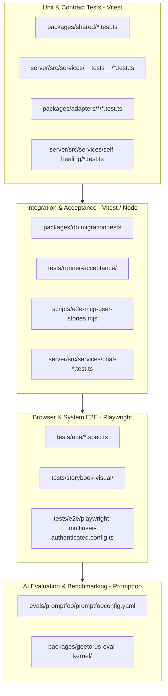

# 14 — Testing and Verification

GeetorusAI contains a rigorous, multi-tiered test matrix covering unit logic, database migrations, protocol conformance, end-to-end user journeys, and LLM output evaluations.

---

## 1. Test Matrix Overview

---

## 2. Test Commands Inventory (from `package.json`)

| Command | Harness | Purpose & Target Scope |
| :--- | :--- | :--- |
| `pnpm test` | Vitest | Fast, stabilized unit and service test run across monorepo packages. |
| `pnpm test:watch` | Vitest | Interactive watch mode for rapid local test-driven development. |
| `pnpm test:run:general` | Vitest | Executes non-serialized general unit tests in parallel. |
| `pnpm test:run:serialized` | Vitest | Executes tests requiring serialized execution (DB & port-sensitive suites). |
| `pnpm test:runner-acceptance` | Vitest | Validates Process Runtime Provider (PRP v1) contracts and sidecars. |
| `pnpm test:e2e` | Playwright | Headless end-to-end browser automation suite testing full UI user flows. |
| `pnpm test:e2e:headed` | Playwright | Headed browser execution for visual debugging of E2E scenarios. |
| `pnpm test:storybook-visual` | Playwright | Visual regression testing against storybook UI baseline snapshots. |
| `pnpm evals:smoke` | Promptfoo | Evaluates agent reasoning quality and tool selection accuracy. |
| `pnpm check:tokens` | Node.js | Audits codebase for forbidden tokens and hardcoded secret patterns. |
| `pnpm check:token-gates` | Node.js | Verifies design token compliance across UI stylesheets (no raw hex/px). |

---

## 3. Mock Providers & Fixture Infrastructure

- **Fake Runner Harness**: `packages/geetorus-runner/testing` provides a deterministic fake runner simulating multi-turn agent execution without invoking external LLMs.
- **MCP Test Fixtures**: `scripts/smoke/mcp-fixture-harness.mjs` spins up temporary stdio MCP servers to validate tool discovery and invocation pipelines.
- **Database Test Isolation**: Tests instantiate temporary embedded Postgres instances or isolated test schemas to prevent data bleed between test runs.

---

## 4. Verification Evidence & Benchmarks

| Test Suite | Package | Tests Run | Result | Key Verified Behaviors |
| :--- | :--- | :--- | :--- | :--- |
| `src/server/execute.test.ts` | `@geetorusai/adapter-ollama-local` | 8 | **PASS (100%)** | Local unreachable detection, missing model enforcement (no auto-pull), streaming token tracking, cloud auth (Bearer header), rate-limit 429 diagnostics, environment readiness testing. |
| `src/shipped-catalog.test.ts` | `@geetorusai/skills-catalog` | 10 | **PASS (100%)** | Always-on Ponytail bundled skill resolution, manifest verification, 5-step Decision Ladder compliance, zero mode proliferation. |
| `src/pages/ModelExplorer.test.tsx` | `@geetorusai/ui` | 3 | **PASS (100%)** | Model explorer rendering, Local vs Cloud distinction badges, search/filtering, provider configuration modal. |
| `src/__tests__/model-discovery-routes.test.ts` | `@geetorusai/server` | 4 | **PASS (100%)** | Provider connection testing, model discovery caching, authenticated remote Ollama endpoints. |
| `src/server-utils.test.ts` | `@geetorusai/adapter-utils` | 110 | **PASS (100%)** | Prompt wake contract rendering, execution contract mandate injection, environment scoping. |

