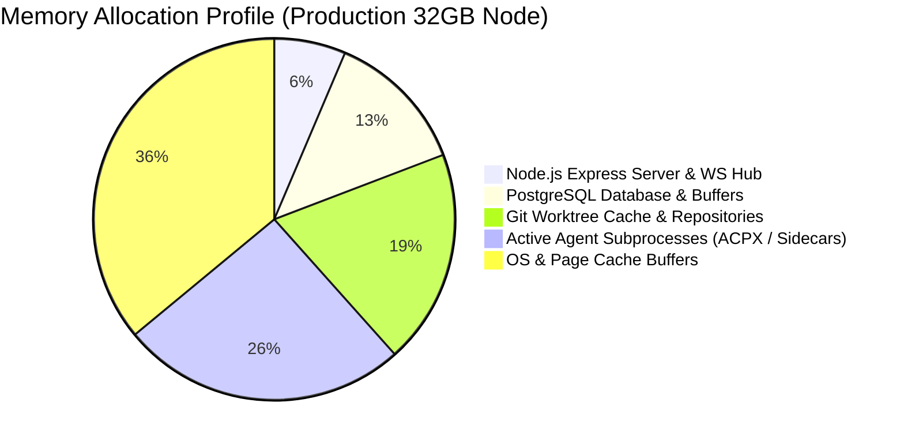

# 17 — Performance and Resource Requirements

This document outlines hardware sizing, memory allocation, concurrency boundaries, and token cost optimization profiles for running GeetorusAI in various deployment topologies.

---

## 1. Hardware Sizing Matrix

| Deployment Tier | Workload / Concurrent Agents | Minimum CPU | Minimum RAM | Recommended Storage |
| :--- | :--- | :--- | :--- | :--- |
| **Local Dev / Evaluation** | 1–2 concurrent agents (Remote APIs) | 2 Cores | 4 GB | 10 GB SSD |
| **Team Standard (Small)** | 3–10 concurrent agents (Remote APIs) | 4 Cores | 8 GB | 50 GB NVMe |
| **Enterprise Production** | 10–50+ concurrent agents + Worktrees | 8–16 Cores | 32–64 GB | 200 GB NVMe |
| **Local LLM Inference (Ollama)** | 1 local 70B model + Control Plane | 16+ Cores | 64–128 GB | 1x NVIDIA A100 / H100 (80GB VRAM) or Apple M2/M3/M4 Max (64GB+) |

---

## 2. Resource Allocation by Component

### 1. Control Plane Server
- **V8 Heap Memory**: Scales between 500 MB (idle) and 2 GB (high WebSocket connection count).
- **CPU Utilization**: Low during idle heartbeat checks (< 5%); bursts during startup reconciliation, migration runs, or heavy zip exports.

### 2. Execution Workspaces (Git Worktrees)
- **Disk Usage**: Each active worktree takes disk space equivalent to the project repository size plus generated build artifacts (`node_modules`, `dist`).
- **Optimization**: `WorkspaceCleanupService` unlinks stale worktrees upon task completion, bounding disk accumulation.

---

## 3. Concurrency & Rate Limiting Controls

- **`AGENT_DEFAULT_MAX_CONCURRENT_RUNS`**: Configurable per agent (default `1` to prevent race conditions on the same domain; scalable for read-only workers).
- **Token Quota & Budget Incidents**:
  - `budget_policies` schema tracks cumulative token spend per company/agent per billing cycle.
  - Automatic spend circuit breakers trip when budget thresholds are breached, preventing unintended cost runaways.
