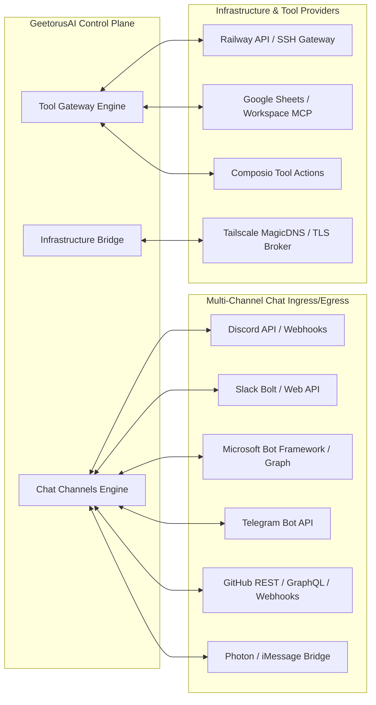

# 18 — External Dependencies and Integrations

This document provides a comprehensive inventory of all third-party libraries, protocols, cloud services, and external integrations utilized across GeetorusAI.

---

## 1. Core Frameworks & Runtime Dependencies

| Package / Framework | Version Pin | Purpose | Failure Impact |
| :--- | :--- | :--- | :--- |
| **Node.js** | `>= 24.11.0` | Server runtime engine | Application will not start |
| **pnpm** | `9.15.4` | Monorepo package manager | Build & dependency resolution errors |
| **Express** | `^4.21.0` | Ingress HTTP router & API gateway | Critical: No API endpoints available |
| **Drizzle ORM** | `^0.36.0` | Type-safe SQL query engine & migrations | Critical: No database access |
| **embedded-postgres** | `18.1.0-beta.16` (Patched) | Zero-dependency local PostgreSQL engine | Fallback to external PostgreSQL |
| **React** | `^19.2.8` | Frontend UI component engine | UI will not render |
| **Vite** | `^6.0.0` | Frontend bundler & dev server with HMR | Cannot build or serve UI |
| **Playwright** | `^1.62.1` | E2E browser automation & visual testing | E2E test runs disabled |
| **Vitest** | `^4.1.11` | Monorepo unit & integration test runner | Unit tests disabled |

---

## 2. External Service Integrations

---

## 3. Degradation & Outage Resiliency Matrix

| Integration | Outage Symptoms | System Mitigation & Resiliency Behavior |
| :--- | :--- | :--- |
| **Anthropic / OpenAI Outage** | 500 / 503 HTTP errors on agent turns | `RecoveryEngine` trips circuit breaker and switches to local Ollama or backup provider. |
| **Discord / Slack Outage** | Inbound webhook failures | Webhook diagnostics log errors; issue queue remains accessible via Web UI. |
| **Railway API Outage** | Infrastructure tool execution failure | `ToolGateway` returns detailed error payload; agent remains safe without partial deployment. |
| **PostgreSQL Outage** | Database query rejection | `PulseService` logs critical incident; API returns 503 with database reconnection attempts. |
