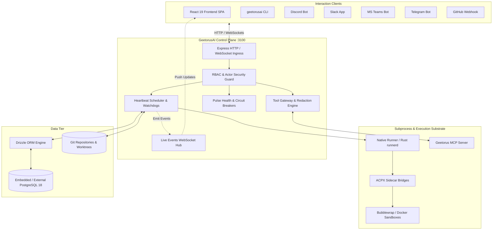
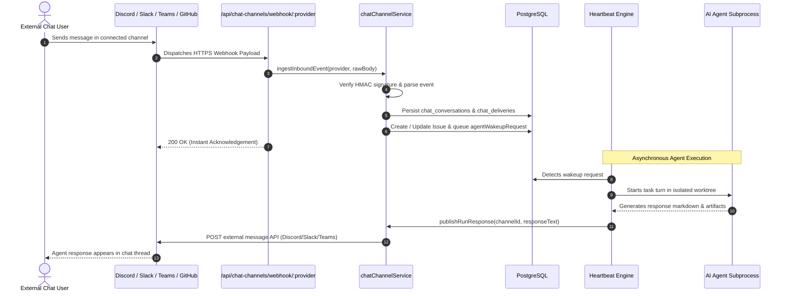
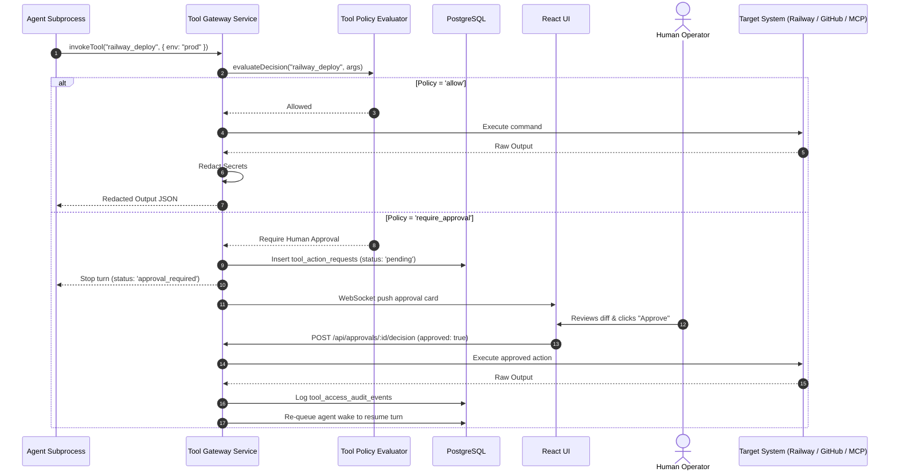
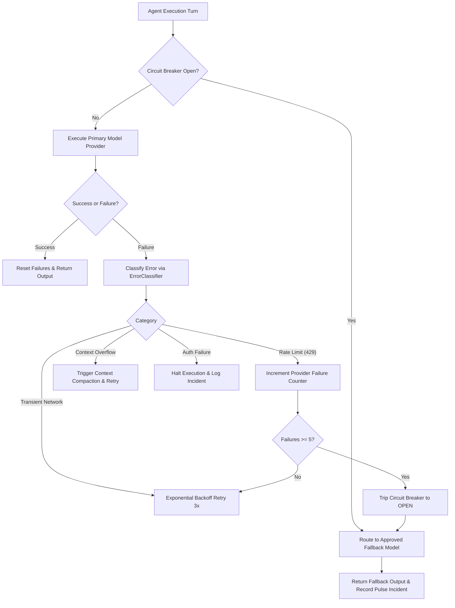

# 21 — Complete System Diagrams

This document collects verified Mermaid diagrams representing the architecture, execution lifecycles, data flows, and security boundaries across GeetorusAI.

---

## 1. Complete System Architecture

---

## 2. Inbound Multi-Channel Message Lifecycle

---

## 3. Tool Execution & Approval Lifecycle

---

## 4. Reliability, Error Classification & Circuit Breaker Failover

