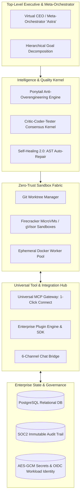
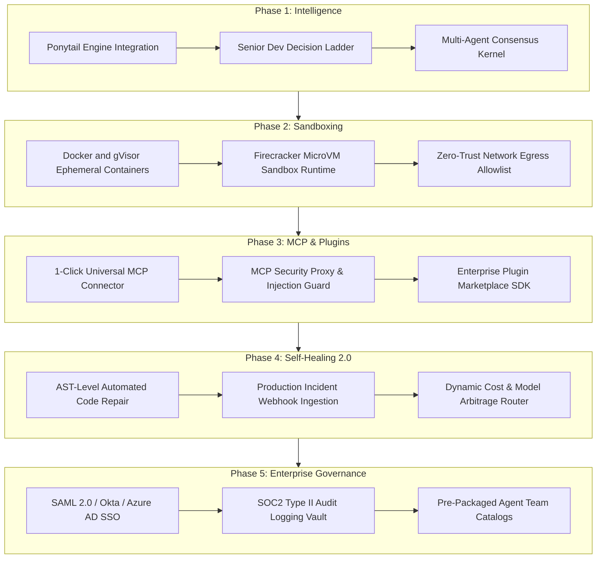
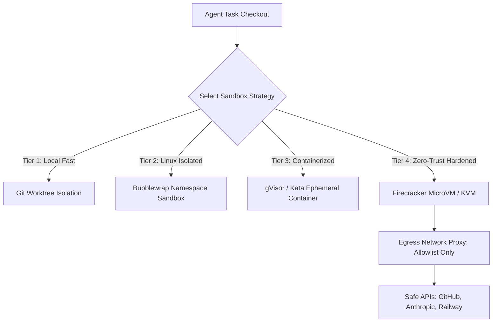
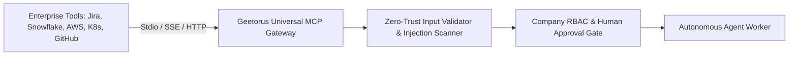
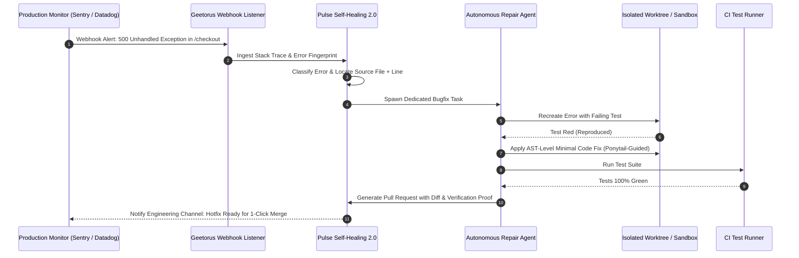

# 23 — Enterprise Production Roadmap: The Sovereign Autonomous Agent OS

This document outlines the strategic, production-grade roadmap to elevate **GeetorusAI** into an industry-leading, enterprise-attracting Autonomous AI Agent Operating System.

It details concrete technical architectures for integrating **Ponytail anti-overengineering intelligence**, **isolated microVM/container sandboxes**, **universal MCP server hubs**, **next-generation self-healing**, and an **enterprise plugin marketplace**.

---

## 🎯 Executive Vision: The Autonomous Enterprise Operating System



---

## 🗺️ The 5-Phase Master Production Roadmap



---

## 📋 Phase 1: Super-Intelligence & Anti-Overengineering (Integrating Ponytail)

### Objective
Prevent AI agents from writing bloated, convoluted, or unnecessary code. Force agents to adopt a "Lazy Senior Architect" mindset: write the minimum, highest-quality code that solves the issue, leveraging existing libraries and standard platform primitives.

### Architecture & Technical Specification

1. **Native Ponytail Ruleset Injection** (from [`DietrichGebert/ponytail`](https://github.com/DietrichGebert/ponytail)):
   - Ingest Ponytail's **Senior Developer Decision Ladder** into `server/src/services/agent-instructions.ts` and ACP sidecar system prompts:
     ```
     [DECISION LADDER - MANDATORY BEFORE ANY CODE CHANGE]
     1. Does this need to exist at all? (YAGNI - You Ain't Gonna Need It)
     2. Is it already in the codebase? (Audit existing utilities before writing new ones)
     3. Does the standard library / platform native feature cover it?
     4. Can it be written in one simple line?
     5. Only then: Write the minimal clean code that solves the problem.
     ```
2. **Automated `/ponytail-review` Gate**:
   - Introduce a pre-commit quality check in `packages/geetorus-runner`.
   - Before an agent commits a Git worktree diff, a dedicated Critic Agent runs `/ponytail-review`:
     - Flags unnecessary abstractions, premature design patterns, and duplicate utilities.
     - Automatically rejects diffs that add redundant code when a native solution exists.
3. **Ponytail Intensity Profiles per Agent**:
   - `lite`: Allows moderate helper functions for prototyping.
   - `full` (Default): Strict decision ladder enforcement; checks codebase before adding deps.
   - `ultra`: Extreme minimal code enforcement; rejects any non-essential lines.

---

## 📋 Phase 2: Enterprise Zero-Trust Sandboxing (MicroVMs & gVisor)

### Objective
Provide guaranteed process, filesystem, and network isolation so Fortune 500 enterprises can run untrusted autonomous agents on proprietary codebases without risk of host contamination, secret theft, or network escapes.



### Technical Specification
1. **Firecracker / gVisor Sandbox Driver**:
   - Implement `FirecrackerSandboxProvider` under `packages/plugins/sandbox-providers/`.
   - Boots a minimal Linux kernel in `<150ms` with hardware-level KVM isolation.
   - Agents receive their own virtual network interface and root filesystem.
2. **Network Egress Allowlisting**:
   - Deny-by-default egress firewall.
   - Agents can only connect to pre-authorized domains (`api.anthropic.com`, `api.github.com`, internal company Git repo).
3. **Secret Masking & Memory-Only Leases**:
   - Secrets are injected directly into environment memory pipes; never written to configuration files on disk.

---

## 📋 Phase 3: Universal MCP Server Gateway & Open Tools Hub

### Objective
Allow any enterprise to connect any external Model Context Protocol (MCP) server with 1 click, turning GeetorusAI into the universal tool hub for all corporate software (PostgreSQL, Snowflake, Jira, Salesforce, AWS, Kubernetes).



### Technical Specification
1. **1-Click MCP Connect in UI (`ui/src/pages/tools/`)**:
   - Support `npx`, `docker run`, or remote HTTPS/SSE MCP endpoints.
   - Auto-discovers all available tool functions, schemas, and descriptions.
2. **MCP Security Proxy & Prompt Injection Scanner**:
   - Scans tool arguments for SQL injection, command chaining (`&&`, `|`, `rm -rf`), and path traversal.
   - Intercepts and scrubs tool outputs for leaked API keys or PII before forwarding to LLM context.
3. **Autonomous MCP Tool Authoring**:
   - When an agent encounters a missing tool (e.g. "Query company internal billing service"), it writes a transient MCP tool script, tests it in its sandbox, and invokes it safely.

---

## 📋 Phase 4: Self-Healing 2.0 & Super-Intelligence Diagnostics

### Objective
Elevate self-healing from simple retry loops to autonomous AST code repair and proactive production incident remediation.

### Technical Specification



1. **AST-Level Targeted Patching**:
   - Uses TypeScript compiler API and AST parsers to replace exact function blocks rather than hallucinating whole file rewrites.
2. **Automated Test-Driven Repair Loop**:
   - Agent writes a reproducing test -> confirms it fails -> applies fix -> verifies test passes -> runs full regression suite.
3. **Dynamic Model & Cost Arbitrage Router**:
   - Routine triaging and simple file reads route to ultra-fast, cheap models (Gemini 2.0 Flash, Llama 3.3).
   - Complex architectural refactoring and security audits dynamically escalate to Claude 3.5 Sonnet or o3-mini.

---

## 📋 Phase 5: Enterprise Governance & Corporate Adoption

### Objective
Provide the compliance, identity, and security features required by Fortune 500 procurement teams (SOC2, SAML SSO, audit logging, multi-region residency).

1. **Enterprise Identity (SAML 2.0 / OIDC)**:
   - Direct integration with Okta, Azure Active Directory, and Google Workspace.
   - Automated SCIM provisioning of team roles and departmental boundaries.
2. **SOC2 Type II Immutable Audit Vault**:
   - Cryptographically signed audit log (`activity_log` + Merkle tree verification) tracking every token spent, tool executed, and code commit authored by AI agents.
3. **Pre-Packaged Agent Team Marketplace**:
   - Ready-to-deploy multi-agent teams:
     - **Full-Stack SaaS Team**: Product Owner Agent + Senior Architect + Frontend Specialist + DevOps Agent.
     - **Cybersecurity Audit Team**: Dependency Vulnerability Scanner + Pen-test Reviewer + Secret Auditor.
     - **Migration Team**: Angular-to-React / Node-to-Rust automated migration squad.

---

## 🏆 Summary: The Corporate Attraction Factor

Implementing this roadmap transforms GeetorusAI from a developer tool into the **gold-standard autonomous AI control plane for enterprises**:

1. **Cost Efficiency via Ponytail**: Enterprises slash token bills by 40–60% by stopping AI code bloat and over-engineering.
2. **Zero-Trust Security via MicroVMs**: Corporate security teams approve deployments knowing agents are isolated in hardware-enforced sandboxes.
3. **Universal Compatibility via MCP**: Connects seamlessly with existing enterprise SaaS stacks (Salesforce, Snowflake, Jira, GitHub) without custom coding.
4. **Proactive ROI via Self-Healing 2.0**: Cuts incident resolution time from hours to minutes through autonomous bug-fixing pipelines.
