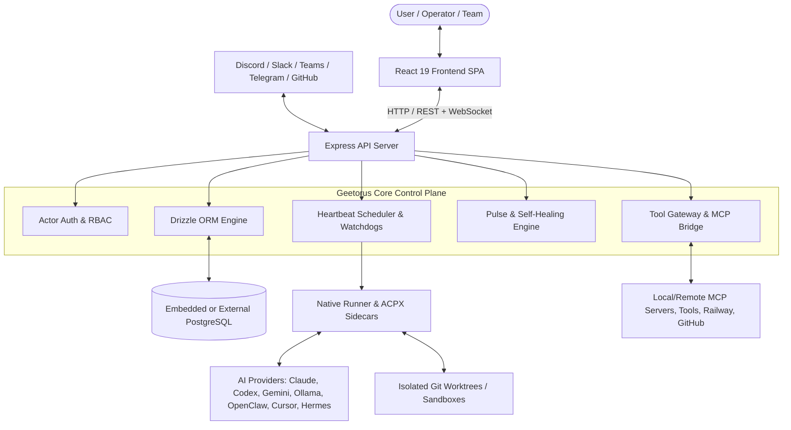

# GeetorusAI — Complete Product & System Documentation

Welcome to the comprehensive, source-verified technical documentation and architectural audit for **GeetorusAI**.

This documentation suite provides an in-depth, verified reference for developers, architects, operators, and evaluators. Every claim, diagram, schema, API route, and mechanism documented in these pages is directly backed by the active codebase.

---

## 📚 Documentation Index

| File | Document Title | Description |
| :--- | :--- | :--- |
| [`01-product-overview.md`](./01-product-overview.md) | **Product Identity and Overview** | Core mission, value proposition, target users, operating environments, key differentiators, and scope boundaries. |
| [`02-codebase-map.md`](./02-codebase-map.md) | **Repository and Codebase Map** | Complete directory hierarchy, package boundaries, entry points, and module responsibilities across the monorepo. |
| [`03-system-architecture.md`](./03-system-architecture.md) | **System Architecture** | Full-stack architecture, runtime boundaries, process topology, data flows, and synchronous/asynchronous boundaries. |
| [`04-feature-inventory.md`](./04-feature-inventory.md) | **Feature Inventory** | Itemized inventory of every system feature with source files, schemas, APIs, and verification status. |
| [`05-working-flows.md`](./05-working-flows.md) | **Complete Functional Flows** | Step-by-step execution flows with Mermaid sequence diagrams (Startup, Chat, Agent Runs, Tool Invocation, Fallback). |
| [`06-functions-classes-and-apis.md`](./06-functions-classes-and-apis.md) | **Functions, Classes, and APIs** | Reference of core backend services, routes, middleware, and public contracts. |
| [`07-ai-models-and-connectivity.md`](./07-ai-models-and-connectivity.md) | **AI Models and Provider Connectivity** | Comprehensive audit of all 13 AI adapters, ACP/CLI protocols, streaming, credential resolution, and fallbacks. |
| [`08-agents-and-tool-execution.md`](./08-agents-and-tool-execution.md) | **Agent System and Tool Execution** | Agent lifecycle, ACPX sidecars, Tool Gateway, MCP servers, sandboxing (Bubblewrap/Docker), and approval gates. |
| [`09-memory-and-context.md`](./09-memory-and-context.md) | **Memory and Knowledge Management** | Conversation history, task context hydration, document annotations, prompt generation, and token boundaries. |
| [`10-data-and-storage.md`](./10-data-and-storage.md) | **Data Model and Storage** | Drizzle ORM schema (137 tables), embedded PostgreSQL supervisor, migrations, relations, and retention policies. |
| [`11-frontend-and-user-experience.md`](./11-frontend-and-user-experience.md) | **Frontend and User Experience** | React 19 + Vite frontend architecture, design token system, route hierarchy, and real-time state synchronization. |
| [`12-security-and-privacy.md`](./12-security-and-privacy.md) | **Security and Privacy Audit** | Multi-tenant isolation, RBAC/actor authorization, secret redaction, prompt injection mitigations, and execution boundaries. |
| [`13-reliability-and-recovery.md`](./13-reliability-and-recovery.md) | **Reliability, Errors, and Self-Healing** | Circuit breakers, error classification, automated failovers, watchdog timers, and startup reconciliation. |
| [`14-testing-and-verification.md`](./14-testing-and-verification.md) | **Testing and Verification** | Vitest unit/integration suites, Playwright E2E suites, Promptfoo evals, and runner acceptance test matrices. |
| [`15-installation-and-development.md`](./15-installation-and-development.md) | **Installation and Development Guide** | Local prerequisites, environment variables, quickstart commands, and developer workflow tips. |
| [`16-deployment-and-operations.md`](./16-deployment-and-operations.md) | **Deployment and Operations** | Docker, bare-metal systemd, Railway, Cloudflare, Tailscale integration, backups, and operational monitoring. |
| [`17-performance-and-resource-requirements.md`](./17-performance-and-resource-requirements.md) | **Performance and Resource Requirements** | Hardware requirements, concurrency limits, token efficiency, memory usage, and bottleneck analysis. |
| [`18-dependencies-and-integrations.md`](./18-dependencies-and-integrations.md) | **External Dependencies and Integrations** | Package manifests, third-party services (Discord, Slack, Teams, Telegram, GitHub, Railway, Composio), and licensing. |
| [`19-limitations-and-known-issues.md`](./19-limitations-and-known-issues.md) | **Product Limitations and Known Issues** | Documented edge cases, platform-specific caveats (Windows PID traps), and technical debt items. |
| [`20-glossary-and-learning-guide.md`](./20-glossary-and-learning-guide.md) | **Glossary and Learning Guide** | Plain-English explanations of Geetorus concepts (Heartbeats, ACPX, Tool Gateway, PRP, Routines, Decisions). |
| [`21-system-diagrams.md`](./21-system-diagrams.md) | **Complete System Diagrams** | Comprehensive Mermaid visual diagrams covering all structural and dynamic system interactions. |
| [`22-master-product-audit.md`](./22-master-product-audit.md) | **Master Product Audit** | Executive synthesis, feature-to-evidence requirements matrix, maturity scoring, and strategic roadmap. |
| [`23-enterprise-production-roadmap.md`](./23-enterprise-production-roadmap.md) | **Enterprise Production Roadmap** | Production-grade roadmap for Ponytail intelligence, microVM sandboxes, universal MCP, and self-healing 2.0. |

---

## 🔍 Quick Architecture Snapshot

---

## 🛠️ Key Monorepo Packages

- **`server/`**: Express API, business logic, multi-channel chat engine, heartbeat orchestration, real-time WebSockets.
- **`ui/`**: React 19 + Vite frontend application with comprehensive operations dashboards and control panels.
- **`packages/db/`**: Complete Drizzle ORM schema with 137 entity tables and embedded PostgreSQL supervisor.
- **`packages/shared/`**: Type contracts, Zod schemas, constants, and permission models.
- **`packages/adapters/`**: 13 AI model provider adapters supporting ACP, CLI, and REST protocols.
- **`packages/geetorus-runner/`**: Native process supervision runtime (Rust runnerd, PRP protocol, ACPX sidecars).
- **`packages/mcp-server/`**: Model Context Protocol client/server bridge for agent-to-platform tool execution.
- **`packages/plugins/`**: Dynamic plugin runtime SDK, worker sandboxes, and scheduled plugin jobs.
- **`cli/`**: Official `geetorusai` CLI tool for provisioning, migrations, backups, and daemon execution.
