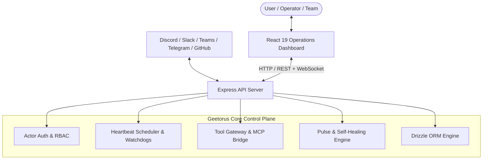

# GEETORUS // COMPLETE TECHNICAL ARCHITECTURE SUITE

```
 ██████╗ ███████╗███████╗████████╗ ██████╗ ██████╗ ██╗   ██╗███████╗
██╔════╝ ██╔════╝██╔════╝╚══██╔══╝██╔═══██╗██╔══██╗██║   ██║██╔════╝
██║  ███╗█████╗  █████╗     ██║   ██║   ██║██████╔╝██║   ██║███████╗
██║   ██║██╔══╝  ██╔══╝     ██║   ██║   ██║██╔══██╗██║   ██║╚════██║
╚██████╔╝███████╗███████╗   ██║   ╚██████╔╝██║  ██║╚██████╔╝███████║
 ╚═════╝ ╚══════╝╚══════╝   ╚═╝    ╚═════╝ ╚═╝  ╚═╝ ╚═════╝ ╚══════╝
```

```
┌─────────────────────────────────────────────────────────────────────────────┐
│ VERIFIED PRODUCT DOCUMENTATION & TECHNICAL AUDIT REGISTER                   │
│ SOURCE-BACKED SPECIFICATION • 23 TECHNICAL CHAPTERS • 100% CODEBASE PARITY │
└─────────────────────────────────────────────────────────────────────────────┘
```

This comprehensive architectural audit provides an in-depth reference for engineers, architects, and operators. Every schema, route, and mechanism documented here corresponds directly to the active production codebase.

---

## 📑 [ TECHNICAL CHAPTERS INDEX ]

| CHAPTER | MODULE SPECIFICATION | OPERATIONAL SCOPE & EVIDENCE |
| :--- | :--- | :--- |
| [`01-product-overview.md`](./01-product-overview.md) | **[01] PRODUCT IDENTITY** | Strategic mission, value proposition, operating environments, and scope boundaries. |
| [`02-codebase-map.md`](./02-codebase-map.md) | **[02] REPOSITORY TOPOLOGY** | Complete directory hierarchy, package boundaries, entry points, and responsibilities. |
| [`03-system-architecture.md`](./03-system-architecture.md) | **[03] SYSTEM ARCHITECTURE** | Full-stack architecture, runtime boundaries, process topology, and data pipelines. |
| [`04-feature-inventory.md`](./04-feature-inventory.md) | **[04] FEATURE INVENTORY** | Itemized inventory of every system feature with source files, schemas, and verification. |
| [`05-working-flows.md`](./05-working-flows.md) | **[05] FUNCTIONAL FLOWS** | Step-by-step sequence diagrams: Startup, Chat, Agent Runs, and Fallbacks. |
| [`06-functions-classes-and-apis.md`](./06-functions-classes-and-apis.md) | **[06] APIS & CONTRACTS** | Reference of core backend services, routes, middleware, and public contracts. |
| [`07-ai-models-and-connectivity.md`](./07-ai-models-and-connectivity.md) | **[07] MODEL ADAPTERS** | Audit of AI adapters, ACP/CLI protocols, streaming, and credential resolution. |
| [`08-agents-and-tool-execution.md`](./08-agents-and-tool-execution.md) | **[08] TOOL EXECUTION** | Agent lifecycle, ACPX sidecars, Tool Gateway, MCP servers, and sandbox guards. |
| [`09-memory-and-context.md`](./09-memory-and-context.md) | **[09] MEMORY & CONTEXT** | Conversation history, task hydration, vector embeddings, and token limits. |
| [`10-data-and-storage.md`](./10-data-and-storage.md) | **[10] DATA MODEL** | Drizzle ORM schema (137 tables), embedded PostgreSQL supervisor, and migrations. |
| [`11-frontend-and-user-experience.md`](./11-frontend-and-user-experience.md) | **[11] UI ARCHITECTURE** | React 19 + Vite frontend architecture, brutalist design token system, and routes. |
| [`12-security-and-privacy.md`](./12-security-and-privacy.md) | **[12] SECURITY & PRIVACY** | Multi-tenant isolation, RBAC authorization, secret redaction, and prompt mitigations. |
| [`13-reliability-and-recovery.md`](./13-reliability-and-recovery.md) | **[13] SELF-HEALING** | Circuit breakers, error classification, automated failovers, and watchdogs. |
| [`14-testing-and-verification.md`](./14-testing-and-verification.md) | **[14] VERIFICATION SUITE** | Vitest unit/integration suites, Playwright E2E suites, and test matrices. |
| [`15-installation-and-development.md`](./15-installation-and-development.md) | **[15] INSTALLATION GUIDE** | Local prerequisites, environment variables, quickstart commands, and dev hygiene. |
| [`16-deployment-and-operations.md`](./16-deployment-and-operations.md) | **[16] DEPLOYMENT GUIDE** | Docker, bare-metal systemd, Railway, Tailscale private access, and backups. |
| [`17-performance-and-resource-requirements.md`](./17-performance-and-resource-requirements.md) | **[17] PERFORMANCE SPEC** | Hardware benchmarks, concurrency limits, token efficiency, and memory profiling. |
| [`18-dependencies-and-integrations.md`](./18-dependencies-and-integrations.md) | **[18] DEPENDENCY AUDIT** | Package manifests, third-party integrations (Discord, Slack, GitHub), and licensing. |
| [`19-limitations-and-known-issues.md`](./19-limitations-and-known-issues.md) | **[19] LIMITATIONS & DEBT** | Documented edge cases, platform-specific caveats (Windows PID traps), and backlogs. |
| [`20-glossary-and-learning-guide.md`](./20-glossary-and-learning-guide.md) | **[20] SYSTEM GLOSSARY** | Explanations of core primitives: Heartbeats, ACPX, Tool Gateway, and Routines. |
| [`21-system-diagrams.md`](./21-system-diagrams.md) | **[21] SYSTEM DIAGRAMS** | Complete Mermaid diagrams covering structural and dynamic runtime interactions. |
| [`22-master-product-audit.md`](./22-master-product-audit.md) | **[22] MASTER AUDIT** | Executive synthesis, feature-to-evidence requirements matrix, and maturity scores. |
| [`23-enterprise-production-roadmap.md`](./23-enterprise-production-roadmap.md) | **[23] PRODUCTION ROADMAP** | Industrial roadmap: Ponytail intelligence, microVM sandboxes, and universal MCP. |

---

## 🔍 [ TOPOLOGY SNAPSHOT ]


